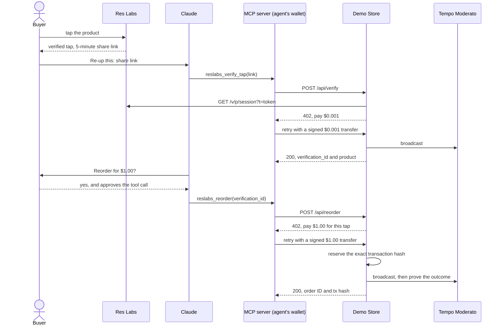

# Res Labs Re-up demo

A buyer taps a product they own. Res Labs verifies the tap and gives the buyer a share link that expires 5 minutes after the tap. The buyer pastes the link into an AI agent. The agent pays $0.001 over MPP (Machine Payments Protocol) on Tempo to have the Demo Store check the link with Res Labs. After the buyer confirms, the agent pays $1.00 to reorder the same product. One tap buys at most one reorder.

Every payment is pathUSD on the Tempo Moderato testnet, paid from the agent's wallet. The MCP server in this repository holds that wallet's private key and signs each payment.

This repository contains the Demo Store, the MCP server, the chain checks behind them, a local stand-in for Res Labs, and end-to-end suites that pay real testnet pathUSD.

## How a tap becomes a paid reorder



The store reads the tap from Res Labs on every verify request, paid or not, and rejects an expired or foreign link before any charge. The agent signs each transfer, and the store's `mppx` server broadcasts it. The store uses no fee payer, so the hash the agent signs is the hash that lands on chain.

| Path | Contents |
|---|---|
| `apps/store` | The Demo Store, a Next.js app. It serves `POST /api/verify`, `POST /api/reorder`, the product page `/` and the orders page `/orders`. It keeps its ledger in SQLite and starts the reconciler from `instrumentation.ts`. |
| `apps/mcp` | A stdio MCP server with the tools `reslabs_verify_tap` and `reslabs_reorder`. It holds the agent's wallet and checks every charge before it signs. `manifest.json` packages it as a Claude Desktop Extension. |
| `packages/chain-proof` | `createChainProof()`, which returns `finalizedBlockNumber()` and `resolveAttempt(attempt)`. The store and `pnpm reconcile` use it to decide what happened to a payment. |
| `scripts/mock-session.ts` | A local stand-in for Res Labs, started with `pnpm mock`. |
| `scripts/reconcile.ts` | A read-only report of open payment attempts, started with `pnpm reconcile`. |
| `scripts/fault-proxy.ts` | A JSON-RPC proxy between the store and Moderato that can drop, hang or strip RPC traffic. The adversarial and fault suites use it. |
| `e2e/` | The live Moderato suites, plus `harness.ts`, which starts an isolated stack for each run. |

The store has two paid endpoints:

| Route | Request body | Price | Success response |
|---|---|---|---|
| `POST /api/verify` | `{ "link": "<share link>" }` | $0.001 | `verification_id`, `tap_id`, `batch_id`, `batch_code`, `product_name`, `vendor_name`, `coa_url`, `sku`, `price`, `payer`, `tx_hash`, `created_at` |
| `POST /api/reorder` | `{ "verification_id": "ver_..." }` | `DEMO_PRICE` | `order_id`, `tap_id`, `amount`, `payer`, `tx_hash`, `explorer_url`, `already_ordered` |

## One tap buys at most one reorder

Verify fees have no reservation. Each paid verify call costs $0.001 and returns a new `verification_id`. Every verification of one tap shares that tap's single reorder.

The reorder is different. `mppx` answers 402 for every failed broadcast, even when the transfer already went through. A 402 therefore proves nothing about the money. The store reserves the exact signed transaction hash before broadcast and releases the tap only when the chain proves that transaction can never settle. The code is in `apps/store/lib/reorder.ts`, `apps/store/lib/binding.ts` and `packages/chain-proof`.

1. The store checks its ledger first. If the tap already has an order, the store returns it with `already_ordered: true` and charges nothing. If the tap has a `pending` or `review` attempt, the store answers 409 `settlement_pending` or 409 `needs_review`. If the verification is more than 15 minutes old, the store answers 410 `verification_expired`.
2. The store issues a 402 challenge for `DEMO_PRICE` and records it against the tap in `issued_challenges`.
3. When the signed credential arrives, `bindCredential` checks it without touching the chain. The challenge must carry the store's HMAC, belong to this tap, be unused and unexpired, and ask for `DEMO_PRICE` pathUSD to `MPP_RECIPIENT` on chain 42431. The signed Tempo transaction must come from the credential's payer and make exactly one `transferWithMemo` call that pays that amount to that recipient. Its memo must be bound to the challenge ID. It must use an expiring nonce and set `validBefore` no more than 30 seconds ahead. If any check fails, the store answers 400 and broadcasts nothing.
4. The store computes the hash of the exact transaction `mppx` will broadcast. In one SQLite transaction, it marks the challenge used and inserts a `pending` row in `payment_attempts`, keyed by that hash. A partial unique index allows one `pending`, `paid` or `review` attempt per tap, so a concurrent second request fails here.
5. Only then does `mppx` broadcast. If it returns 200 with a receipt for the reserved hash, the store marks the attempt `paid` and inserts the order in the same SQLite transaction. If the receipt names any other hash, the attempt becomes `review`.
6. If `mppx` returns anything else or throws, the store calls `resolveAttempt` once a second until 15 seconds after `validBefore`, and answers from the result:

| `resolveAttempt` result | Attempt becomes | Response |
|---|---|---|
| `settled-paid` | `paid`, with an order | 200 with the order |
| `settled-no-transfer` | `review` | 409 `needs_review` |
| `reverted-no-transfer` | `dead` | 402 `payment_not_settled`, with a fresh challenge |
| `dead` | `dead` | 402 `payment_not_settled`, with a fresh challenge |
| `unknown`, or time runs out | stays `pending` | 503 `settlement_pending` |

`resolveAttempt` sends the finalized block and the transaction receipt in one JSON-RPC batch. A receipt above the finalized block counts as `unknown`. A finalized receipt counts as paid only if it holds a `TransferWithMemo` log on pathUSD from the payer to `MPP_RECIPIENT` for exactly `DEMO_PRICE`. With no receipt, the result is `dead` only after the store reads every block from the attempt's `created_block` through the first block whose timestamp reaches `validBefore`, and none of them contains the hash. Block timestamps never decrease and `validBefore` is exclusive, so no later block can include that transaction. A null block or an RPC error makes the result `unknown`.

Only a `dead` attempt frees the tap for a new payment. The store never matches a payment by sender, recipient or amount, and it never releases an attempt because time passed. The reconciler applies the same table to every `pending` attempt when the store boots and every 15 seconds after. A person settles `review` attempts by hand.

The agent's wallet has its own guards in `apps/mcp/src/payments.ts`:

- It pays only pathUSD, only on chain 42431, and only to `MPP_RECIPIENT`.
- It refuses any single charge above 1.10 pathUSD.
- It refuses a charge that would bring the server process's total above 10.00 pathUSD. The total grows when the wallet signs and never shrinks, because a 402 or 5xx after the credential leaves does not prove the store never broadcast it. Restart the MCP server to reset the total.
- It pays at most once per tool call (`maxPaymentRetries: 1`).

## What the store needs from Res Labs

A tap verified by Res Labs yields a 5-minute share link on `https://verify.reslabs.ai/v/p?t=<token>`. The store reads that tap from one endpoint, `GET https://api.reslabs.ai/v/p/session?t=<token>`. The endpoint answers 200 with the tap's result while the link is live. It answers 401 for an unknown token or an expired link. It is not a documented public contract, so treat it as specific to this demo.

The store reads only these fields and ignores the rest: `variant`, `verified`, `tap.id`, `batch.id`, `batch.batch_code`, `batch.product_name`, `provenance_summary.brand_name` and `coa.lab_coa_url`. It never logs, stores or returns the raw response. `/api/verify` maps the session result to these errors, and charges nothing for any of them:

| Error | Status | Cause |
|---|---|---|
| `bad_link` | 400 | The link is not a `/v/p` link with a `t` parameter on `RESLABS_LINK_ORIGIN`. |
| `link_expired` | 410 | The session endpoint answered 401. |
| `not_eligible` | 422 | The tap is not verified, its batch is not `DEMO_BATCH_ID`, or a required field is missing. |
| `reslabs_unavailable` | 502 | The session endpoint answered another status, or did not answer within 5 seconds. |

## Set up Moderato wallets

The demo needs one funded wallet, one address and one secret:

- The agent's wallet pays every charge, so it needs pathUSD. It also pays its own transaction fees in pathUSD.
- The store's recipient address, `MPP_RECIPIENT`, receives the payments. It needs no funds.
- `MPP_SECRET_KEY` is a random secret the store uses to sign its MPP challenges.

To create them:

1. Create the agent's wallet. `npx mppx account create` creates a named local account, and `npx mppx account export --account <name>` prints its private key. Any 0x-prefixed 32-byte private key also works.
2. Create a recipient address the same way.
3. Fund the agent's wallet from the Moderato faucet:

	```sh
	curl -X POST https://tempo.xyz/developers/api/faucet \
		-H 'Content-Type: application/json' \
		-d '{"address":"0xYOUR_AGENT_ADDRESS"}'
	```

4. Generate the store secret with `openssl rand -hex 32`.

Moderato is chain 42431. Its RPC is `https://rpc.moderato.tempo.xyz`, and pathUSD is the token at `0x20c0000000000000000000000000000000000000`. Transactions open at `https://explore.testnet.tempo.xyz/tx/<hash>`.

## Run the demo with the mock

`scripts/mock-session.ts` stands in for Res Labs on `http://localhost:4010`, so you can run the whole agent flow without a tag. `POST /mint` returns a share link for a new synthetic tap. `GET /v/p/session?t=<token>` serves that tap's synthetic result. It answers 401 for an unknown link or for a link minted more than 5 minutes ago.

You need Node.js 22.12 or later, pnpm 12, and Claude Code. Run every command from the repository root.

1. Install the dependencies:

	```sh
	pnpm install
	```

2. Copy the example environment:

	```sh
	cp .env.example .env
	```

3. In `.env`, set `MPP_SECRET_KEY` and `MPP_RECIPIENT`. The other values already point at the mock.
4. Start the mock in one terminal. It prints `mock-session listening on http://localhost:4010`.

	```sh
	pnpm mock
	```

5. Start the store in a second terminal. It serves the product page on `http://localhost:3000`.

	```sh
	pnpm dev:store
	```

6. Build the MCP server and add it to Claude Code. Use the agent's private key and the same `MPP_RECIPIENT` as in `.env`.

	```sh
	pnpm --filter @reup/mcp build
	claude mcp add --transport stdio \
		--env AGENT_KEY=0xYOUR_AGENT_PRIVATE_KEY \
		--env STORE_URL=http://localhost:3000 \
		--env MPP_RECIPIENT=0xYOUR_RECIPIENT_ADDRESS \
		reslabs-reup -- node "$PWD/apps/mcp/dist/index.js"
	```

7. Mint a share link. The reply is `{"link":"http://localhost:4010/v/p?t=..."}`.

	```sh
	curl -X POST localhost:4010/mint
	```

8. Within 5 minutes, start an interactive `claude` session and send `Re-up this: <link>`. The agent calls `reslabs_verify_tap`, which pays $0.001 and shows the product, vendor, vendor batch, COA and price. The agent then asks you to confirm the reorder.
9. Confirm in chat, then answer **Yes** when Claude Code asks to run `reslabs_reorder`. The tool pays $1.00 and returns the order ID and an explorer link for the transaction.
10. Open `http://localhost:3000/orders`. The page lists the order with its product, amount, payer and transaction.

`reslabs_reorder` sets `_meta["anthropic/requiresUserInteraction"]`. With Claude Code 2.1.292 on Moderato, the tool showed a Yes or No approval prompt in the default interactive mode and under `--dangerously-skip-permissions`. The prompt has no option to stop asking. Headless `claude -p` can verify a tap but cannot reorder. Claude Code denied the reorder call with `MCPTool requires permission`, even with the tool in `--allowedTools` and permissions bypassed. Run the reorder step in an interactive `claude` session. Other permission modes are untested.

Until every required store variable is valid, the store fails with `Missing or invalid store environment variables: <names>`. To see a rejected tap, mint a link for another batch with `curl -X POST localhost:4010/mint -d '{"batch_id":"another-batch"}'`. The store answers `not_eligible` and charges nothing. To start over with an empty ledger, stop the store and delete `apps/store/data/`.

### Use a real tap instead of the mock

To check real Res Labs taps, set these values in `.env` and restart the store:

- `RESLABS_LINK_ORIGIN=https://verify.reslabs.ai`
- `RESLABS_SESSION_URL=https://api.reslabs.ai/v/p/session`
- `DEMO_BATCH_ID`, set to the vendor batch ID of the tagged product. The store accepts taps of that batch only.

The buyer taps the product, copies the 5-minute share link from `verify.reslabs.ai`, and pastes it into the agent.

## Use Claude Desktop

To install the server in Claude Desktop, package it as a Desktop Extension:

```sh
pnpm --filter @reup/mcp extension
```

The command writes `apps/mcp/reslabs-reup.mcpb`. Open the `.mcpb` file with Claude Desktop to install it. The install form asks for the agent's wallet private key, the Demo Store URL and the Demo Store payment address. The extension passes them to the server as `AGENT_KEY`, `STORE_URL` and `MPP_RECIPIENT`. `manifest.json` marks the private key as sensitive.

Then set the extension's tool permissions in Claude Desktop (Customize, then Connectors, then Tool permissions). Anthropic documents per-tool permissions for Desktop Extensions. This setup has not yet been exercised in Claude Desktop.

| Tool | Permission | Intended result |
|---|---|---|
| `reslabs_verify_tap` | **Always allow** | The agent pays the $0.001 fee without a prompt. |
| `reslabs_reorder` | **Needs approval** | Claude Desktop asks before every reorder. Click **Allow once** to pay. |

## Run the end-to-end suites

The suites run against live Moderato and pay real testnet pathUSD. Each suite builds the MCP server and starts its own stack. The stack runs the mock and the store (`next build`, then `next start`) on free ports. Its store uses a fresh random recipient address, so balance checks never mix with other runs. Its SQLite file, Next.js build and logs go to `.e2e/<run-id>/`.

The suites read wallets from `.e2e/keys.json`, which is gitignored:

```json
{
	"agents": [
		{ "pk": "0xPRIVATE_KEY", "address": "0xADDRESS" },
		{ "pk": "0xPRIVATE_KEY", "address": "0xADDRESS" },
		{ "pk": "0xPRIVATE_KEY", "address": "0xADDRESS" },
		{ "pk": "0xPRIVATE_KEY", "address": "0xADDRESS" }
	],
	"mppSecretKey": "RANDOM_SECRET"
}
```

`pnpm e2e:happy` pays from `agents[1]`, `pnpm e2e:adversarial` from `agents[2]` and `pnpm e2e:faults` from `agents[3]`. `agents[0]` is not read by any suite. Fund the three suite wallets with the faucet before you run the suites. `mppSecretKey` is the store's MPP secret for every suite stack. Each suite exits non-zero if any assertion fails. `pnpm e2e` runs the three suites in that order.

### `pnpm e2e:happy`

The suite runs the full flow three times through the MCP server, each time on a fresh tap. Each run checks these results on chain and in the store:

- The recipient receives exactly 0.001 pathUSD for the verify and exactly 1.00 pathUSD for the reorder.
- Both transactions open on the explorer.
- `/orders` lists the order with its payer and transaction.
- A second reorder with the same verification returns the existing order with `already_ordered: true`.
- A reorder with a new verification of the same tap also returns the existing order. The only new payment to reach the recipient is the second verify fee.

### `pnpm e2e:adversarial`

The suite sends reorder credentials that the store must refuse before broadcast. For each one, it checks for a 400 response, no new `payment_attempts` row, no transaction sent through the RPC proxy, and no change to the agent's balance. The suite covers these cases:

- a valid credential for one tap, sent with another tap's `verification_id`
- a challenge with a tampered ID, or with a rewritten expiry
- a challenge signed with another secret
- a challenge the store signed but never issued
- a challenge that an earlier attempt already used
- an expired challenge
- a transaction whose memo is bound to another challenge
- a transaction without an expiring nonce
- a transaction whose `validBefore` is in the past, or more than 30 seconds ahead
- an already-settled $1.00 transfer, wrapped in a new credential

The suite also points the MCP server at a store priced at 2.00 pathUSD. The agent's wallet refuses to sign, and its balance stays the same.

### `pnpm e2e:faults`

The suite puts `scripts/fault-proxy.ts` between the store and Moderato and runs each case on a fresh tap:

| Fault | Expected result |
|---|---|
| The proxy forwards the broadcast, then drops the reply (`drop-after-forward`). | Exactly one 1.00 transfer reaches the recipient. The attempt ends `paid` with an order, and a later reorder returns that order without a charge. |
| The proxy forwards the broadcast, then never replies (`hang-after-forward`). | The same as `drop-after-forward`. |
| The proxy strips the transfer logs from the receipt (`strip-receipt-logs`). | The attempt ends `review`. Every later reorder for that tap answers 409 `needs_review` and pays nothing. |
| The proxy drops the broadcast before it forwards it (`drop-before-forward`). | The transaction never reaches the chain. The attempt stays `pending` until the store has read every block through `validBefore`, then ends `dead`. The next reorder pays once. |
| The store restarts while the proxy holds the broadcast reply. | On boot, the reconciler resolves the `pending` attempt to `paid` with an order. The client never retries. |

## Run the unit tests and checks

`pnpm test` runs the unit tests in each package. `pnpm typecheck` runs TypeScript in each package, and `pnpm lint` runs Biome on the repository.

## Report open payments

`pnpm reconcile` lists every `pending` and `review` attempt in the store's SQLite file, with the current `resolveAttempt` result for each. It reads `TEMPO_RPC_URL`, `MPP_RECIPIENT`, `DEMO_PRICE` and `STORE_DB_PATH` from `.env`, opens the database read-only, and writes nothing. When nothing is open, it prints `No pending or review attempts.`

The store resolves `pending` attempts itself, on boot and every 15 seconds. Settle `review` attempts by hand. The store never refunds testnet orders.

## Environment variables

`.env.example` lists every variable with a placeholder value. The store, `pnpm mock` and `pnpm reconcile` read the repository-root `.env`. The MCP server reads only its own launch environment.

| Variable | Read by | Value |
|---|---|---|
| `MPP_SECRET_KEY` | store | A random secret that signs MPP challenges. |
| `MPP_RECIPIENT` | store, MCP server, `pnpm reconcile` | The Moderato address that receives payments. The MCP server pays no other address. |
| `DEMO_BATCH_ID` | store, `pnpm mock` | The UUID of the vendor batch the store sells. The mock mints taps for this batch. |
| `DEMO_SKU` | store | The SKU label on the product page and in verify results. |
| `DEMO_PRICE` | store, `pnpm reconcile` | The reorder price in pathUSD, as a decimal with at most 6 fraction digits, such as `1.00`. The MCP server refuses any charge above 1.10 pathUSD. |
| `RESLABS_LINK_ORIGIN` | store | The origin every share link must have. The mock uses `http://localhost:4010`, and Res Labs uses `https://verify.reslabs.ai`. |
| `RESLABS_SESSION_URL` | store | The session endpoint. The mock uses `http://localhost:4010/v/p/session`, and Res Labs uses `https://api.reslabs.ai/v/p/session`. |
| `TEMPO_RPC_URL` | store, `pnpm reconcile` | The Moderato RPC, `https://rpc.moderato.tempo.xyz`. |
| `STORE_DB_PATH` | store, `pnpm reconcile` | Optional. The SQLite file, relative to `apps/store`. The default is `data/store.db`. |
| `STORE_DIST_DIR` | store | Optional. The Next.js build directory, relative to `apps/store`. The default is `.next`. |
| `MOCK_PORT` | `pnpm mock` | Optional. The mock's port. The default is `4010`. |
| `AGENT_KEY` | MCP server | The private key of the agent's wallet. |
| `STORE_URL` | MCP server | The Demo Store base URL, such as `http://localhost:3000`. |

The verify fee ($0.001) and the pathUSD address are constants in the code, not variables.

## Testnet only

This is a testnet demo. Every payment is pathUSD on Tempo Moderato, which has no monetary value. Use only testnet keys. The Demo Store fulfills nothing. An order is a row in SQLite, and no product ships. Every store page shows a "Testnet demo, no real orders" banner and a "For research use only" label.

## Pre-existing work

Res Labs' tag verification, COA (certificate of analysis) and share links are pre-existing, closed-source work, and they are not in this repository. The contest work is this repository: the Demo Store, the MCP server, `chain-proof`, the mock, the scripts and the end-to-end suites. The repository contains no Res Labs code. It reaches Res Labs only through the share link and the session endpoint.

## License

MIT. See `LICENSE`.
